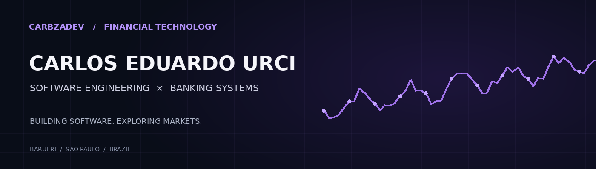

### Software Engineering · Banking Technology · Quantitative Finance

*Building real-world software and exploring the intersection of technology, data and financial markets.*

[**Português**](#português) · [**English**](#english) · [**Projects**](#projects--projetos)

---

## Português

Olá! Sou **Carlos Eduardo Urci**, desenvolvedor em evolução, baseado em **Barueri, São Paulo**. Construo projetos de software e tenho interesse em engenharia de sistemas, dados e tecnologia para o mercado financeiro.

Meu objetivo de longo prazo é trabalhar com **software para bancos e instituições financeiras**, aprofundando conhecimentos em sistemas confiáveis, bancos de dados, automação, algoritmos e computação quantitativa.

<strong>Áreas de interesse / Areas of interest</strong>

- Engenharia de software e arquitetura de sistemas
- Sistemas bancários e infraestrutura financeira
- Bancos de dados e engenharia de dados
- Automação, algoritmos e desempenho
- Mercados financeiros e computação quantitativa

## English

Hi! I'm **Carlos Eduardo Urci**, an aspiring software developer based in **Barueri, São Paulo, Brazil**. I build software projects and enjoy learning about systems engineering, data and financial technology.

My long-term goal is to work on **software for banks and financial institutions**, developing strong foundations in reliable systems, databases, automation, algorithms and quantitative computing.

---

## Stack / Tecnologias

**Web development / Desenvolvimento web**

**Tools / Ferramentas**

> These are technologies used in my current web projects. My interests in banking and quantitative finance represent areas I'm working toward, not professional experience I claim to have.

---

## Projects / Projetos

### Aura Odontologia

**PT:** Website institucional para uma clínica odontológica, construído com **Next.js e TypeScript**, com foco em interface, responsividade e experiência do usuário.

**EN:** Institutional website for a dental clinic, built with **Next.js and TypeScript**, focusing on interface design, responsiveness and user experience.

**Status:** Private repository / Repositório privado. Public code and demo are not yet available.

---

## Roadmap / Próximos passos

| Em desenvolvimento / In progress | Direção / Direction |
| --- | --- |
| Software engineering | Clean code, testing and system design |
| Data and databases | SQL, modeling and data pipelines |
| Financial technology | Banking systems and financial APIs |
| Quantitative computing | Python, statistics and market data |

---

**Engineering software with purpose.**

[GitHub](https://github.com/carbzadev) · Barueri, São Paulo, Brazil

